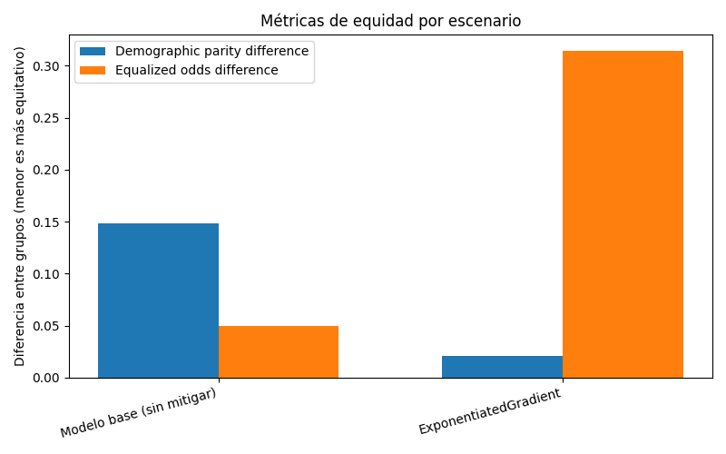
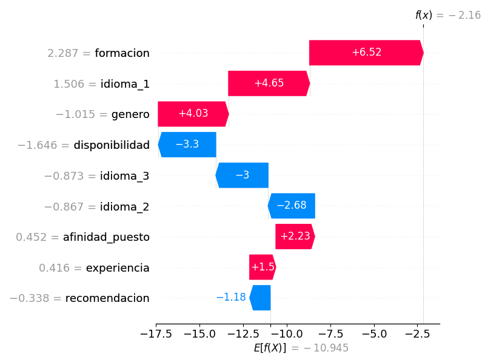
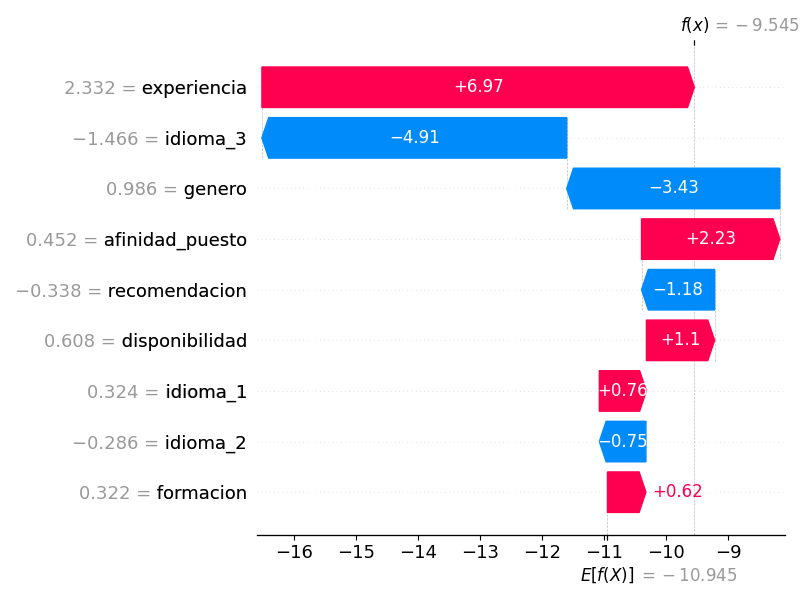
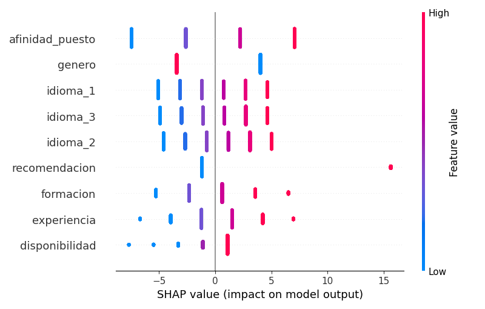
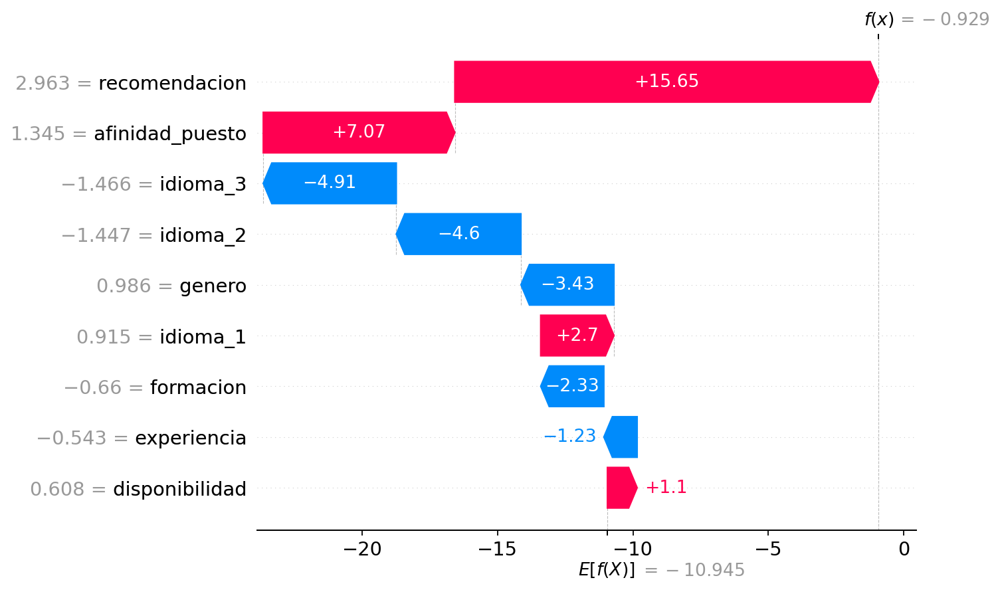
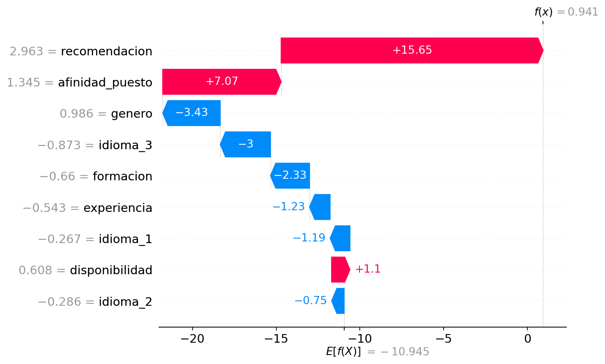

# Evidencias — Auditoría de equidad, mitigación y explicabilidad

Autor: Tadeo Rivas. Ejecución en GitHub Codespaces del 19 de octubre de 2026.
Valores redondeados a tres decimales, tomados de la salida de la corrida.

## Datos y configuración

FairCVdb de BiDAlab es un benchmark sintético de reclutamiento con 24.000
perfiles. Se toma una muestra aleatoria de 10.000 perfiles con semilla 42.
Se combinan las particiones originales y se realiza el split estratificado
de la plantilla: 7.000 filas para entrenamiento y 3.000 para prueba.
El preprocesamiento se ajusta solo sobre entrenamiento.

| Parámetro | Valor |
|---|---|
| Dataset | `data/faircvdb_genero.csv` |
| Objetivo y clase positiva | `preseleccionado`, clase `1` |
| Regla del objetivo | Puntaje con sesgo de género de FairCVdb ≥ 0,5 |
| Atributo sensible | `genero`: 0 = masculino; 1 = femenino |
| Modelo base | Regresión logística |
| Mitigación | `exponentiated_gradient` |
| Restricción | `demographic_parity` |
| Semilla | 42 |

El umbral 0,5 es una decisión de esta práctica, no una regla de Amazon.
Se utilizan el género y ocho variables de competencias o afinidad con el
puesto. Los puntajes sesgados y neutrales originales quedan fuera de los
predictores, al igual que nombres, imágenes, biografías e identificadores.
El género se conserva para estudiar su influencia directa.

### Composición de la muestra y etiquetas

| Grupo | No preseleccionado | Preseleccionado | Total |
|---|---:|---:|---:|
| Masculino (0) | 3758 | 1203 | 4961 |
| Femenino (1) | 4607 | 432 | 5039 |

Los grupos tienen tamaños similares, pero las etiquetas positivas se
distribuyen de forma desigual: aproximadamente 24,2 % en el grupo masculino
y 8,6 % en el femenino. El sesgo se introduce en la generación de etiquetas
del benchmark. Equilibrar solamente el número de perfiles por grupo no lo
eliminaría.

## Auditoría del modelo base

| Grupo | Exactitud | Tasa de selección predicha |
|---|---:|---:|
| Masculino (0) | 0,976 | 0,239 |
| Femenino (1) | 0,980 | 0,090 |

La exactitud global es 0,978. La *demographic parity difference* vale 0,149
y la *equalized odds difference* vale 0,050. Ambas se calculan con Fairlearn.
La primera mide la mayor diferencia de tasas de selección entre grupos;
la segunda toma la mayor de las diferencias entre las tasas de verdaderos
positivos y entre las tasas de falsos positivos.

El modelo selecciona al 23,9 % del grupo masculino y al 9,0 % del femenino:
una brecha de 14,9 puntos porcentuales. Las exactitudes por grupo son
similares y elevadas, pero miden la coincidencia con etiquetas que contienen
una penalización de género. Por eso no acreditan decisiones equitativas ni
idoneidad laboral real.

El patrón es consistente con el problema documentado por Dastin (2018):
aprender de datos sesgados puede perjudicar a las candidatas. Amazon utilizó
currículums y aprendió señales asociadas al género; esta simulación incluye
explícitamente `genero` entre los predictores. Estos números cuantifican el
experimento con FairCVdb y no estiman la magnitud de la discriminación del
sistema de Amazon.

## Comparación antes y después de la mitigación

| Escenario | Exactitud | Demographic parity difference | Equalized odds difference |
|---|---:|---:|---:|
| Modelo base | 0,978 | 0,149 | 0,050 |
| ExponentiatedGradient | 0,934 | 0,021 | 0,315 |

ExponentiatedGradient reentrena modelos con distintas ponderaciones para
optimizar la exactitud bajo la restricción de paridad demográfica. La
brecha de selección pasa de 14,9 a 2,1 puntos porcentuales: una reducción
aproximada del 86 % sobre los valores redondeados. Queda una disparidad
residual; el resultado no representa igualdad exacta en test.

La exactitud baja de 97,8 % a 93,4 %, es decir, 4,4 puntos porcentuales.
La brecha de equalized odds aumenta de 5,0 a 31,5 puntos porcentuales. La
mitigación resulta efectiva para el criterio elegido, pero no mejora todas
las métricas a la vez. Además, equalized odds y exactitud siguen evaluándose
contra etiquetas sesgadas: el aumento de esa brecha no demuestra por sí
solo un perjuicio mayor frente a una referencia neutral de competencias.
Las métricas globales disponibles tampoco permiten identificar si domina
la diferencia de verdaderos o de falsos positivos.

El análisis utiliza un único split y una semilla fija. No se calcularon
intervalos de incertidumbre ni se probó generalización a postulantes reales.
La referencia neutral de FairCVdb se usa en los casos individuales del
complemento; sigue siendo una referencia sintética.

## Explicabilidad preventiva con SHAP

SHAP se aplica al modelo base. En esta regresión logística, sus valores
descomponen el puntaje en log-odds, no en puntos de probabilidad. El signo
indica si una variable aumenta o reduce ese puntaje respecto del valor de
referencia de la explicación.

### Selección automática original de la plantilla

| Índice en test | Contribución absoluta de género | Predicción | Etiqueta sesgada |
|---|---:|---:|---:|
| 0, mayor contribución absoluta | 4,032 | 0 | 0 |
| 3, menor contribución absoluta | 3,435 | 0 | 0 |

Los nombres de los archivos provienen de la plantilla. El segundo caso no
acredita ausencia de discriminación: 3,435 sigue siendo una contribución
importante. Comparar el máximo y el mínimo absoluto tampoco muestra por sí
solo si el género cambia la clase.

La auditoría preventiva podría combinar SHAP, métricas por grupo y pruebas
con competencias constantes para investigar el uso del género antes del
despliegue. En Amazon también habría que analizar palabras e instituciones
que actúen como proxies, sin asumir que eliminar el campo explícito de
género elimina la información sensible del resto del CV.

### Comparación controlada complementaria

`completar_shap_faircvdb.py` reconstruye el mismo modelo base y split, y
verifica que la exactitud redondeada sea 0,978. Selecciona automáticamente
el primer índice de test que satisface cada criterio: ambos perfiles
originales son femeninos y tienen referencia neutral sintética positiva.
Se cambia solo la entrada de género a masculino y se mantienen las
competencias.

En el primer caso la decisión cambia de rechazo a preselección. En el
segundo se mantiene la preselección. Que la clase se mantenga no implica
una contribución de género igual a cero. La prueba describe sensibilidad
directa de este modelo y no establece una conclusión causal o legal sobre
personas reales ni sobre el sistema de Amazon.

Los índices, las probabilidades, los valores SHAP firmados y los gráficos
se registran en `outputs/casos_shap.md` y `outputs/casos_shap.json`.
El bloque del complemento se conserva junto con esta interpretación.

<!-- inicio-casos-shap-controlados -->
## Casos SHAP con comparación controlada

Exactitud del modelo base reconstruido: 0,978. Se reutilizan las funciones,
la muestra y la partición de la corrida principal. Se selecciona
automáticamente el primer índice de test que cumple cada criterio.

En ambos casos la etiqueta neutral de FairCVdb es positiva. Se cambia solo
la entrada de género de femenino a masculino, conservando todas las
competencias. La etiqueta neutral es una referencia sintética del dataset,
no una validación de idoneidad laboral real.

### Cambia la decisión

Índice en test: 44. Perfil original femenino; referencia neutral: 1;
etiqueta sesgada: 0.

| Entrada de género | Probabilidad de preselección | Decisión |
|---|---:|---:|
| Femenino (original) | 0,2831 | 0 |
| Masculino (competencias iguales) | 0,9986 | 1 |

SHAP firmado de género: −3,435 en log-odds.

El género femenino contribuye negativamente al puntaje. Al cambiar solo
esa entrada, la probabilidad de preselección pasa de 28,31 % a 99,86 % y
la clase cambia de 0 a 1. El efecto del género resulta decisivo para la
decisión binaria en este perfil.

### Se mantiene la decisión

Índice en test: 78. Perfil original femenino; referencia neutral: 1;
etiqueta sesgada: 1.

| Entrada de género | Probabilidad de preselección | Decisión |
|---|---:|---:|
| Femenino (original) | 0,7193 | 1 |
| Masculino (competencias iguales) | 0,9998 | 1 |

SHAP firmado de género: −3,435 en log-odds.

La preselección se mantiene en ambas entradas de género, aunque la
probabilidad aumenta de 71,93 % a 99,98 % al cambiarla a masculino. Este
caso no presenta un cambio de clase, pero conserva una penalización en el
puntaje asociada al género.

La contribución SHAP es la misma en ambos perfiles porque se explica una
regresión logística lineal en log-odds y el valor de género es el mismo.
Las competencias pueden compensar esa contribución y producir decisiones
distintas. Por eso una menor probabilidad o un valor SHAP negativo no
equivalen automáticamente a un cambio de clase.

Estas pruebas describen sensibilidad directa del modelo en la simulación.
No establecen una conclusión causal o legal sobre personas reales ni
sobre el sistema de Amazon.
<!-- fin-casos-shap-controlados -->

## Procedencia y reproducción

Las instrucciones y versiones están en [README.md](README.md). La preparación
valida el SHA256 de la descarga oficial antes de cargarla y conserva su
procedencia en `outputs/preparacion_faircvdb.json`.

- Dastin, J. (2018, 10 de octubre). *Amazon scraps secret AI recruiting tool
  that showed bias against women*. Reuters.
- Peña et al. (2023). *Human-Centric Multimodal Machine Learning: Recent
  Advances and Testbed on AI-Based Recruitment*.
  https://doi.org/10.1007/s42979-023-01733-0
- Código y diccionario: https://github.com/BiDAlab/FairCVtest
- Definiciones de métricas:
  https://fairlearn.org/v0.11/user_guide/assessment/common_fairness_metrics.html
- SHAP para regresión logística:
  https://shap.readthedocs.io/en/latest/example_notebooks/tabular_examples/linear_models/Sentiment%20Analysis%20with%20Logistic%20Regression.html

La atribución completa de los recursos del benchmark se incluye en README.md.
