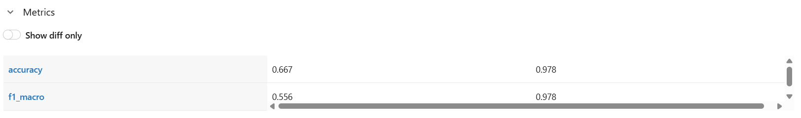
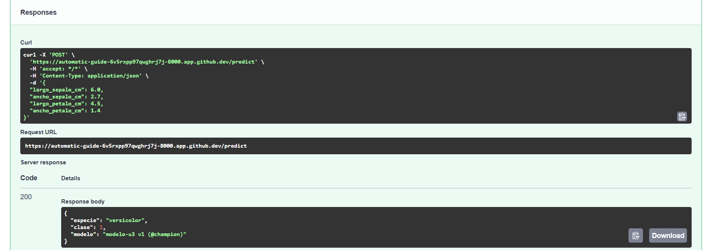
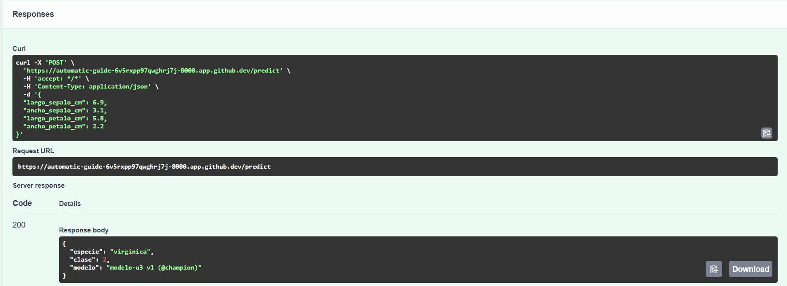
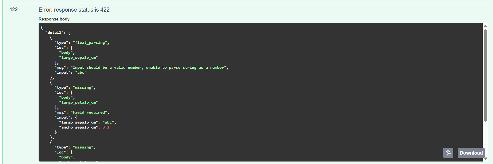
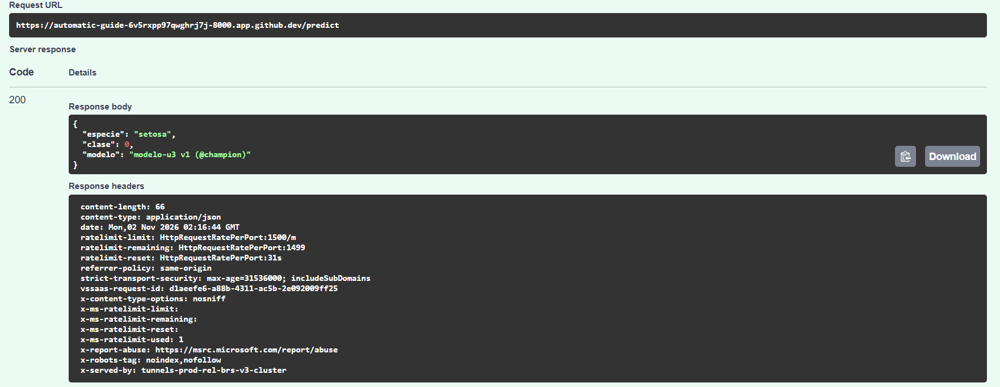

# Resultados de la Unidad 3

**Estudiante:** Tadeo Rivas
**Fecha de entrega:** A completar

## Consigna 6 Preparación del entorno

Se utilizó GitHub Codespaces con la configuración de la Unidad 3.
Se verificaron Python 3.11.18 y Docker 29.9.2.

## Consigna 7 Experimentación y registro con MLflow

| Corrida | max_depth | accuracy | f1_macro |
|---------|-----------|----------|----------|
| arbol_max_depth_1 | 1 | 0.667 | 0.556 |
| arbol_max_depth_3 | 3 | 0.978 | 0.978 |

**Versión registrada:** modelo-u3 v1, con alias @champion, correspondiente a la corrida con max_depth = 3.

 y (capturas/scatter.png)

### Interpretación de los experimentos

El árbol de profundidad 3 obtuvo mejores resultados que el de profundidad 1 en el conjunto evaluado.
La accuracy pasó de 0.667 a 0.978 y el F1 macro de 0.556 a 0.978.
Registrar todas las corridas permite comparar los cambios y conservar evidencia de las alternativas descartadas.
Esto coincide con el uso de MLflow propuesto en la teoría para vincular cada configuración con sus resultados.

## Consigna 8 Serving con FastAPI

La API recibe cuatro medidas de la flor en centímetros, expresadas como números mayores que cero.
Devuelve la especie predicha, el número de clase y la identificación del modelo utilizado.

| Entrada | Respuesta de la API |
|---------|---------------------|
| largo_sepalo_cm: 5.1; ancho_sepalo_cm: 3.5; largo_petalo_cm: 1.4; ancho_petalo_cm: 0.2 | HTTP 200; setosa; clase 0; modelo-u3 v1 (@champion) |
| largo_sepalo_cm: 6.0; ancho_sepalo_cm: 2.7; largo_petalo_cm: 4.5; ancho_petalo_cm: 1.4 | HTTP 200; versicolor; clase 1; modelo-u3 v1 (@champion) |
| largo_sepalo_cm: 6.9; ancho_sepalo_cm: 3.1; largo_petalo_cm: 5.8; ancho_petalo_cm: 2.2 | HTTP 200; virginica; clase 2; modelo-u3 v1 (@champion) |
| largo_sepalo_cm: "abc"; ancho_sepalo_cm: 3.1; sin medidas del pétalo | HTTP 422; valor no numérico y campos obligatorios faltantes |

### Interpretación de la validación

La API devolvió HTTP 422 al recibir un texto en un campo numérico y detectar medidas obligatorias faltantes.
La solicitud fue rechazada en la validación de entrada, antes de ejecutar la predicción.
La respuesta identificó los campos afectados y el motivo de cada error.
En producción, este control evita enviar datos incompatibles al modelo y facilita corregir las solicitudes de otros sistemas.

## Consigna 9 Containerización con Docker

Se construyó la imagen modelo-u3:1.0 y se ejecutó con el puerto 8000 publicado.
La predicción realizada desde el contenedor devolvió HTTP 200, especie setosa, clase 0 y modelo-u3 v1 (@champion).

 y (docker_terminal.png)

### Relación con la estrategia blue-green

Las imágenes modelo-u3:1.0 y modelo-u3:1.1 permitirían ejecutar la versión actual y la candidata en entornos separados.
La versión 1.0 seguiría atendiendo mientras se verifica el funcionamiento de la 1.1.
Después de validarla, un balanceador podría dirigir el tráfico hacia la nueva versión.
Si aparecieran problemas, se podría volver a la anterior conservando su imagen y configuración.